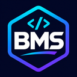

# PyBMS Tools for VS Code



**A practical VS Code extension for [Pybms](https://github.com/aymanboufounas/Pybms)**, a beginner-friendly Python data science and machine learning framework (currently alpha, v0.2.0).

## Features

- **100-function sidebar** grouped into Datasets (20), Cleaning (20), Arrays (15), Plots (15), Training (15), Optimization (10) and Syntax & help (5).
- **Autocomplete and hover documentation** for imports such as `import pybms as pb`, followed by `pb.`. PyBMS already ships `.pyi` stubs for Pylance; this extension adds a framework explorer, shortcuts and recipes.
- **Starter projects and six recipes** for Iris AutoML, CSV training, cleaning, NumPy dense neural networks, gradient descent and syntax repair. Use `PyBMS: Create Starter Project` or `PyBMS: Create Example File`.
- **Python snippets**: type `pbimport`, `pbauto`, `pbdata`, `pbclean`, `pbnet`, `pbplot` or `pbsave` in a Python file.
- **Environment check**, **install/upgrade**, and **run current Python file** using VS Code tasks. Respects `pybms.pythonPath` and auto-detects `.venv`.
- **Syntax checking** using Python's `ast.parse`, without executing source code. Automatic checks happen only when a saved Python file imports PyBMS.
- **Reviewable syntax repair** using `pybms.fix_syntax()`: opens a VS Code diff and asks for explicit confirmation before editing the original. Unsupported errors are not silently altered.
- **No API key, telemetry or paid service required.** Framework installation is separate and requires permission.

## Quick start

1. Install Python **3.10+**. Install this VS Code extension.
2. Open a folder in VS Code. Click the **PyBMS icon** in the Activity Bar, or run `PyBMS: Get Started` from the Command Palette (`Ctrl+Shift+P`).
3. Choose **Create Starter Project**. Pick the Iris AutoML recipe.
4. Run **PyBMS: Install or Update Framework** to install the current GitHub source into your configured Python environment.
5. Open your generated `.py` file and run **PyBMS: Run Current Python File**.

For example:

```python
import pybms as pb

data = pb.load_data('iris')
result = pb.auto_train(data, target='target')
print(result.metrics)
```

## Settings

| Setting | Default | Purpose |
| --- | --- | --- |
| `pybms.pythonPath` | `python` | Python executable. If unchanged, auto-uses workspace `.venv` when available. |
| `pybms.enableSyntaxDiagnostics` | `true` | Syntax-check PyBMS files on save. |
| `pybms.completions` | `true` | Provide PyBMS API completions after imported aliases. |

On Windows, a manually selected interpreter can be `C:\\Python313\\python.exe`. Set this under **Settings → Extensions → PyBMS**. This extension does not automatically activate the Python extension interpreter; configure the same environment in both when necessary.

## Safety and limitations

- The **Install/Upgrade** action explicitly asks before running `pip install --upgrade` from the official Pybms GitHub archive. Network access is needed for installation.
- **Run Current Python File** runs your own file on request; it does not execute files in the background.
- Syntax diagnostics use the Python parser. The syntax repair feature imports an installed PyBMS and calls `fix_syntax`; the source is sent through stdin and is **not run**. The diff and confirmation allow review of all changes.
- Some functions show a short fallback signature in the offline sidebar (`name(...)`). For the exact signature, use the [complete PyBMS API reference](https://github.com/aymanboufounas/Pybms/blob/main/docs/API_REFERENCE.md) or `python -m pybms help <name>`.
- PyBMS 0.2.0 is an **alpha** framework. The recipes are illustrative, not assurances of model quality. Avoid training/test leakage; use appropriate group/time-series validation where needed. Only load trusted `.joblib` artifacts.
- The publisher ID in `package.json` is `aymanbms`, matching the official publisher account used to upload this extension.

## Build / packaging

The extension uses **plain JavaScript with no runtime npm dependencies**:

```bash
node --check src/extension.js
npm test
python scripts/package_vsix.py
```

The packaging script writes `dist/pybms-tools-0.1.1.vsix`. For the standard Microsoft packaging path, you can instead run `npx @vscode/vsce package` (requires network access). It includes an icon, marketplace manifest, README and license.

To install a VSIX locally, open VS Code Extensions, choose `...` → **Install from VSIX**, and select the `.vsix` file. Upload the same VSIX from your [Visual Studio Marketplace publisher portal](https://marketplace.visualstudio.com/manage/publishers/).

## Developer links

- [Framework source](https://github.com/aymanboufounas/Pybms)
- [100-function reference](https://github.com/aymanboufounas/Pybms/blob/main/docs/API_REFERENCE.md)
- [Extension source/issues](https://github.com/aymanboufounas/Extension)

**MIT License** — Ayman Boufounas.
